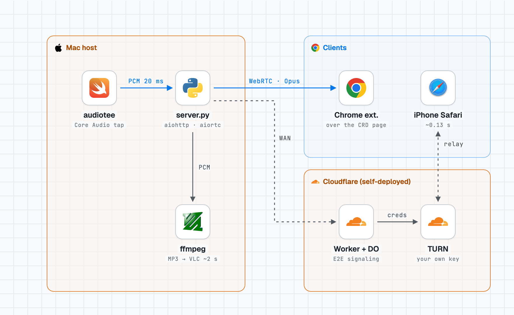

# CRD Audio Sidecar

Chrome Remote Desktop (CRD) does not carry a macOS host's sound. This sidecar captures the Mac's system audio and sends it on a separate path — WebRTC to a browser or a Chrome extension drawn on top of the CRD page, with an MP3 stream as a fallback — while the screen stays in CRD.

<picture>
  <source media="(prefers-color-scheme: dark)" srcset="docs/stack-dark.png">
  
</picture>

## Problem

CRD shows and controls a Mac remotely but plays no audio from it, so music, video and calls on the host are silent on the client. Routing audio through a virtual device (BlackHole) works but forces the Mac's own output away from its speakers or headphones. The client side also varies: a desktop browser inside the CRD page, and phones that switch apps and keep playing in the background.

## Approach

```
Mac system audio → Core Audio tap (audiotee) → server.py ─┬→ WebRTC (Opus) → desktop Chrome extension / iPhone & iPad Safari  (~0.13 s on iPhone)
                                                         └→ HTTP MP3      → VLC on a phone                                  (~2 s)
```

- **Capture without changing the output device.** The default capture is a Core Audio process tap through [audiotee](https://github.com/makeusabrew/audiotee), built from a pinned commit by `build_audiotee.sh`; it delivers 20 ms stereo 48 kHz frames. BlackHole remains as a fallback (`--capture blackhole`).
- **Low-latency path: WebRTC.** `server.py` (aiohttp + aiortc) fans the frames out to each peer as Opus over `/offer`. iPhone/iPad Safari keeps playing after switching to the CRD app.
- **Chrome MV3 extension.** A speaker button and volume slider are drawn over `remotedesktop.google.com`; the background script relays signaling. Volume uses a squared gain curve (50 ≈ −12 dB) and the on/off state and volume are remembered.
- **Fallback: HTTP MP3** (`/stream.mp3`, 48 kHz stereo 192 kbps via ffmpeg) for VLC on a phone.
- **Outside the home network (experimental).** A Cloudflare Worker + Durable Object relays end-to-end encrypted signaling, paired by QR code; audio stays peer-to-peer (DTLS-SRTP). When the carrier NAT blocks P2P, the Worker issues short-lived Cloudflare TURN credentials (3 h TTL, 30 per host per hour). A UPnP port-mapping experiment to avoid TURN was started but not finished; what was tried is in [TROUBLESHOOTING.md](TROUBLESHOOTING.md) #10.

## Results

Measured by hand on the author's setup (Mac mini, macOS 27):

| Path | Client | Result |
|---|---|---|
| WebRTC | iPad Chrome (Phase 1, BlackHole capture) | sound, 0 packet loss, jitter buffer ~128 ms |
| WebRTC | iPhone Safari | ~0.13 s; keeps playing after switching to the CRD app |
| WebRTC + extension | Chrome on a Windows laptop, over the CRD page | sound confirmed |
| HTTP MP3 | VLC on a phone, minimum network caching | ~2 s end to end (server path ~0.4 s, the rest is VLC's buffer) |
| Cloud signaling + TURN | iPhone on LTE | sound confirmed; STUN alone failed behind the carrier NAT |

Eleven problems met along the way and their fixes are recorded in [TROUBLESHOOTING.md](TROUBLESHOOTING.md).

## Tech stack

- Python 3.12: aiohttp, aiortc, PyAV, numpy, sounddevice, cryptography, qrcode
- audiotee (Swift, Core Audio taps; macOS 14.2+), BlackHole as a fallback
- ffmpeg (libmp3lame) for the MP3 stream
- Chrome extension (Manifest V3, JavaScript, Web Audio)
- Cloudflare Workers + Durable Objects (wrangler), Cloudflare TURN
- Diagram: [stack-diagram](https://github.com/caru-ini/stack-diagram) (icons: svgl, gilbarbara/logos)

## Run

```bash
python3.12 -m venv .venv
.venv/bin/pip install -r requirements.txt
./build_audiotee.sh                      # builds audiotee into vendor/
.venv/bin/python server.py               # options: --port 8080 --bitrate 192k
```

Grant **System Audio Recording** permission to the terminal app first (System Settings → Privacy & Security → Screen & System Audio Recording); without it the tap records silence and reports no error. Then open `http://<mac-ip>:8080` on a phone, or load `extension/` as an unpacked extension in Chrome and enter the server address. Full steps are in [README.ko.md](README.ko.md).

Do not listen from the Mac's own browser: the tap captures everything the Mac plays, so the received sound is captured again and feeds back.

**Outside the LAN (optional).** There is no hosted instance. Deploy `signaling/` to your own Cloudflare account and, for the TURN fallback, use your own Cloudflare Realtime TURN key:

```bash
cd signaling && npm install
cp .env.example .dev.vars                  # local test with `npx wrangler dev`; fill in your own values
npx wrangler secret put TURN_KEY_ID      # for a deploy; repeat for TURN_KEY_API_TOKEN
npx wrangler deploy
cd .. && .venv/bin/python server.py --signal wss://<your-worker>.<your-account>.workers.dev
```

Without the TURN values the Worker still relays signaling; only the relay fallback is off.

## Lessons learned

- **Silent failures were the hardest bugs.** A missing TCC permission gives a tap that records zeros without an error, and an output set to BlackHole gives the same result in tap mode. A capture test (`capture_test.py --tap`) that checks for signal now comes first.
- **Measure each segment before blaming one.** A 10 s mobile delay looked like a server problem; timing a test tone through the server showed ~0.4 s, and the rest was the phone browser's buffer.
- **P2P is not enough on mobile networks.** STUN failed on LTE behind the carrier NAT, so a TURN fallback with a per-host rate limit was added.
- **Limits.** Installation needs a Python venv, a Swift build and manual permission steps; the host runs only on macOS; outside-network use is still an experiment, and its TURN limit is per host (30 per hour), not per deployment. A signed menu-bar app and a store extension are designed in [DEPLOYMENT.md](DEPLOYMENT.md) but not built.

## License

MIT, see [LICENSE](LICENSE). audiotee and BlackHole are not included; `build_audiotee.sh` fetches audiotee under its own license.

## References

- audiotee — Core Audio tap CLI. https://github.com/makeusabrew/audiotee
- aiortc — WebRTC for Python. https://github.com/aiortc/aiortc
- BlackHole — virtual audio driver. https://github.com/ExistentialAudio/BlackHole
- Cloudflare Realtime TURN. https://developers.cloudflare.com/realtime/turn/

---
한국어 문서: [README.ko.md](README.ko.md)
